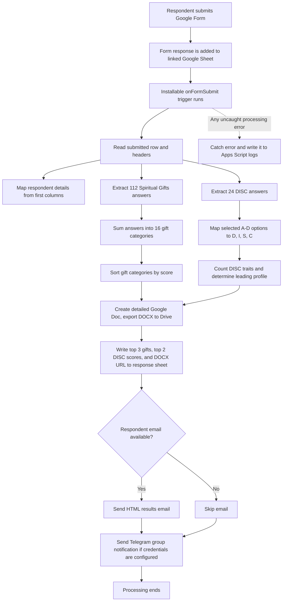

# Spiritual Gifts & Personality Assessment — Application Flow

This document describes the submission-processing flow implemented by `Editor/Code_V2.gs`. The script is a Google Apps Script automation that processes assessment responses stored in a Google Sheet, calculates Spiritual Gifts and DISC results, then writes and distributes the results.

## Flow diagram

## Processing steps

1. **Submission trigger and input**
   - `onFormSubmit(e)` is intended to run when a form response is submitted.
   - It uses the event's response range to identify the sheet and row, with the active sheet and last row as fallbacks.
   - It reads the header row and submitted row, then maps respondent information such as email, names, sex, and Telegram/phone using header keywords (including supported Khmer labels).

2. **Spiritual Gifts scoring**
   - The script reads 112 gift responses from row values at indexes `6` through `117` (`values.slice(6, 118)`).
   - It assigns each answer to one of 16 categories using the question number modulo 16, adds the numeric answer to that category's total, and looks up category names and references in `SPIRITUAL_GIFTS_META`.
   - Categories are sorted from highest to lowest score. The top three are used in the response-sheet summary; the full ranking is included in notifications and the generated report.

3. **DISC scoring**
   - The script reads 24 DISC responses from indexes `118` through `141` (`values.slice(118, 142)`).
   - For each response it reads the leading A–D choice and uses `DISC_MAPPING` to increment one of the `D`, `I`, `S`, or `C` counters.
   - The four scores are sorted to determine the leading profile. `DISC_PROFILES_META` supplies profile descriptions and related content for the report and email.

4. **Detailed report generation**
   - `createAssessmentDocx(...)` creates a temporary Google Doc containing respondent details, all gift and DISC questions with their answers, and the calculated scores.
   - It exports the document as a `.docx` file into the configured Google Drive folder, trashes the temporary Google Doc, and returns the DOCX URL.

5. **Spreadsheet summary**
   - `ensureSummaryColumnsAndWrite(...)` finds or creates six summary columns: the top three Spiritual Gifts, the top two DISC profiles, and the report file URL.
   - It writes the calculated values to the submission's row.

6. **Result delivery**
   - If an email address was captured, `sendAssessmentResultEmail(...)` sends a formatted HTML email with gift rankings, the leading gift description, DISC scores and profile information, and links to additional assessment resources.
   - `sendTelegramNotification(...)` sends the respondent details, gift rankings, DISC summary, and DOCX URL to the configured Telegram chat. It skips delivery when `TELEGRAM_BOT_TOKEN` or `TELEGRAM_CHAT_ID` is missing.
   - Errors that escape the processing steps are caught by `onFormSubmit` and written to the Apps Script log.

## Dependencies and configuration

The script relies on assessment data and mappings defined elsewhere in the Apps Script project, including `SPIRITUAL_GIFTS_META`, `SPIRITUAL_GIFTS_DESCRIPTION`, `SPIRITUAL_GIFTS_QUESTIONS`, `DISC_MAPPING`, `DISC_QUESTIONS`, and `DISC_PROFILES_META`. It also requires an appropriately configured form-submit trigger and authorization for the Google Sheets, Drive, Docs, Gmail, and external URL-fetch services it uses. Telegram delivery requires the `TELEGRAM_BOT_TOKEN` and `TELEGRAM_CHAT_ID` script properties. The DOCX destination is selected by the Drive folder ID in `createAssessmentDocx`.

## Implementation considerations

- The answer-column slices depend on the response sheet retaining the expected column order: respondent fields first, then 112 gift answers, then 24 DISC answers.
- DISC response parsing expects each answer to begin with A, B, C, or D. Unexpected or blank values should be validated before mapping to avoid aborting the submission handler.
- The code's tied-DISC-profile blend formatting and category/question indexing are implementation details worth verifying against the intended scoring rules if those rules change.
