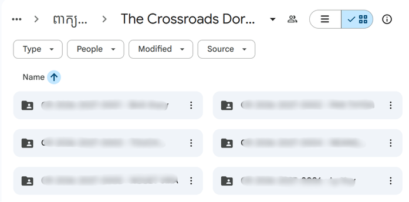
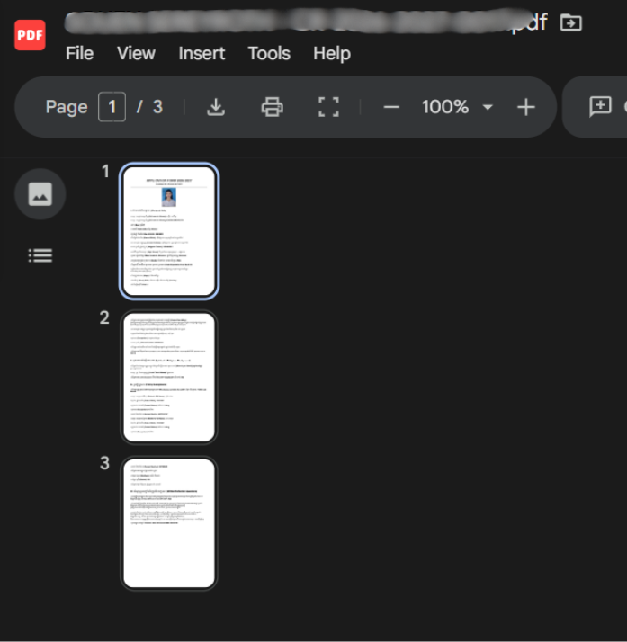
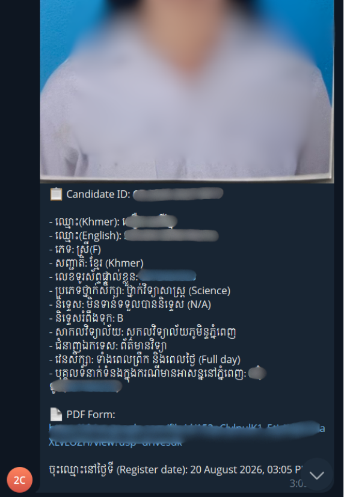

# Dormitory Application System — Overall Flow

## Overview

This Google Apps Script automates the **2026–2027 Crossroads Dormitory application process**. It starts when a Google Form response is submitted and performs candidate numbering, document creation, PDF generation, Drive storage, Telegram notification, and Google Sheets updates.

## Application Flow Diagram

```mermaid
flowchart TD
    A[Applicant opens the Google Form] --> B[Applicant submits the form]
    B --> C[Google Forms on-submit trigger calls onFormSubmit]

    C --> D{Valid event and namedValues?}
    D -- No --> E[Log error and stop processing]
    D -- Yes --> F[Read submitted answers]

    F --> G[Determine registration timestamp]
    G --> H[Generate Candidate ID: CR-2026-2027-####]

    H --> I[Open the configured Main Drive folder]
    I --> J[Create candidate folder]

    J --> K{ID photo submitted?}
    K -- Yes --> L[Extract Google Drive photo file ID]
    L --> M{Photo accessible?}
    M -- Yes --> N[Load photo file]
    M -- No --> O[Log photo error]
    K -- No --> O

    N --> P[Create a Google Document]
    O --> P

    P --> Q[Move document into candidate folder]
    Q --> R[Set A4 size and margins]
    R --> S[Add candidate ID and personal information]

    S --> T{Photo available?}
    T -- Yes --> U[Insert photo proportionally into the document]
    U --> V[Copy photo into candidate folder]
    T -- No --> W[Skip photo insertion]

    V --> X[Save and close the document]
    W --> X

    X --> Y[Export the document as PDF]
    Y --> Z[Save PDF in candidate folder]
    Z --> AA[Get the PDF sharing URL]

    AA --> AB[Create Telegram summary message]
    AB --> AC{Photo available?}
    AC -- Yes --> AD[Send photo and caption to the Telegram chat]
    AC -- No --> AE[Send text message to the Telegram chat]

    AD --> AF[Update the submitted Google Sheet row]
    AE --> AF

    AF --> AG[Write AX:BC headers if absent]
    AG --> AH[Write Candidate ID, Docs link, PDF link, folder link, statuses]
    AH --> AI[Log success]

    E --> AJ[Throw error and log stack trace]
```



## Step-by-Step Process

### 1. Form submission

A Google Form submit trigger passes an event object to `onFormSubmit(e)`. The script verifies that the event contains `namedValues`, which is the map of form questions to submitted answers.

### 2. Response extraction

The script reads applicant information such as:

- Khmer and Latin names
- Sex and nationality
- Date and place of birth
- Current address and Telegram contact
- High-school and examination information
- University, major, shift, and year
- Emergency contact and health information
- Spiritual and church background
- Family and sibling information
- Written reflection answers

The `getAnswer()` helper finds values by comparing form question names and supports partial and case-insensitive matching.

### 3. Candidate identification

`createCandidateID()` obtains and increments `CANDIDATE_NUMBER` in Apps Script properties. The resulting ID follows this format:

```text
CR-2026-2027-0001
CR-2026-2027-0002
```

The counter is global to the script and continues increasing until the property is reset manually.

### 4. Drive folder structure

The script creates one candidate folder in the configured main folder:

```text
Main Dormitory Folder/
└── CR-2026-2027-0001 - Candidate Name/
    ├── Candidate Name - CR-2026-2027-0001 (Google Doc)
    ├── Candidate Name - CR-2026-2027-0001.pdf
    └── Candidate Name - CR-2026-2027-0001 (photo copy)
```

A photo is optional. If it is not provided or cannot be accessed, processing continues without it.



### 5. Google Document and PDF

The script creates a Google Document with:

- A4 page dimensions
- Configured margins
- A centered application title
- The candidate ID
- Personal information sections
- Spiritual and family information
- Written reflection answers
- Registration date
- Optional applicant photo

The document is saved in the candidate folder, then exported as a PDF.



### 6. Telegram notification

The script builds a concise candidate summary containing the candidate ID, names, sex, nationality, academic information, emergency contact, PDF link, and registration date.

It sends:

- A photo plus the candidate summary when a photo is available
- A text-only summary when no photo is available

Telegram delivery uses the configured bot token and chat ID.



### 7. Google Sheet update

The script updates the row that triggered the form submission. It writes six headers in columns AX through BC:

| Column | Header |
|---|---|
| AX | Candidate ID |
| AY | Google Docs Link |
| AZ | PDF Form Link |
| BA | Candidate Folder Link |
| BB | Telegram Status |
| BC | System Status |

The row receives the generated candidate ID, document and PDF links, candidate-folder link, `Sent`, and `Completed`.

## Error Handling

- Missing form-submit event data raises a descriptive error.
- Photo lookup and photo insertion failures are logged, and the remaining workflow continues.
- Unexpected errors are logged with a stack trace and rethrown.
- Telegram success or API failure should be detected from the Telegram API response. The current implementation always writes `Sent` before confirming the response body or HTTP status.

## External Services

| Service | Purpose |
|---|---|
| Google Forms | Collect applicant responses |
| Google Apps Script | Run the automation |
| Google Drive | Store candidate folders, photos, documents, and PDFs |
| Google Docs | Generate the formatted application document |
| Google Sheets | Record links and processing status |
| Telegram Bot API | Notify staff of new applications |

## Required Trigger

An **On form submit** trigger must be installed for `onFormSubmit`. The trigger's event must provide `e.namedValues` and `e.range`.

## Security and Configuration Notes

- The Telegram bot token and all folder/chat identifiers must be treated as secrets or private configuration.
- `TELEGRAM_BOT_TOKEN` should not be committed to source control in plaintext. Move sensitive values to `PropertiesService` or another secret-management approach.
- Candidate names are cleaned before they are used for file names.
- Telegram chat IDs and Drive folder IDs should be verified before production use.
- Google Form uploads and Google Drive files should use appropriate sharing permissions so the script can access them.
- The Telegram status in the sheet should verify the Bot API response rather than assuming success.
